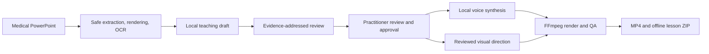

# Narrate Medical Studio

Narrate Medical Studio is a local Windows application for turning medical PowerPoint decks into reviewed narration, animated 1080p video, captions, and an interactive lesson package.

The application is designed for practitioners who need to inspect the source, correct OCR, edit the teaching script, direct visual emphasis, and approve an exact revision before release. After dependencies and models are installed, presentation content and model inference stay on the workstation.

The workflow is presentation-agnostic and medical-domain specialized. The supplied injection deck is a validation input, not a hard-coded template.

> **Project status:** functional development release. It is not clinically validated, production certified, or approved for unsupervised medical publishing. The local evaluator is a review aid and still produces false findings.

## Highlights

- React 19 and TypeScript authoring interface; no Streamlit.
- FastAPI backend with local SQLite and filesystem artifacts.
- `.pptx` and `.pptm` import, safe OOXML extraction, speaker notes, tables, references, and slide rendering.
- Local OCR for image-heavy slides, with confidence and explicit practitioner confirmation.
- Checkpointed source analyst, teacher, and evidence-review stages using local Ollama models.
- Exact evidence spans in reviewer findings; the model cannot invent displayed quotations.
- Qwen3-TTS CustomVoice for expressive narration, plus Kokoro, Piper, and Windows speech alternatives.
- Guided focus, Whiteboard, Studio, and supported native PowerPoint-effect rendering.
- Burned captions, selectable subtitles, chapter navigation, transcript search, and knowledge checks.
- Revision-bound review gates: changing source text, narration, questions, or visual cues invalidates approval.
- MP4 and self-contained offline interactive ZIP exports.

## System overview



The model-assisted stages prepare material for review. Only the practitioner can approve a revision. See [Architecture](docs/MULTI_AGENT_ARCHITECTURE.md) and [Pipeline](docs/PIPELINE.md) for the detailed contracts.

## Current verified result

The supplied 60-slide injection deck completed the private draft pipeline:

| Result | Measurement |
|---|---:|
| Lecture duration | 47 min 11.625 sec |
| Chapters | 60 |
| Knowledge checks | 8 |
| Video | H.264, 1920×1080 |
| Audio | AAC, duration matched to video |
| Subtitle track | Present |
| Offline package | ZIP integrity and packaged-video hash verified |

The output remains permanently marked as an unapproved draft. Opening, slide 57 rotation, and the final caption were visually checked. See [Validation](docs/VALIDATION.md) for measurements and limitations.

## Quick start on the configured workstation

From PowerShell:

```powershell
cd D:\Projects\video_gen
.\Start.ps1
```

Open [http://127.0.0.1:8765](http://127.0.0.1:8765). The server listens only on loopback. Keep the PowerShell window open and press `Ctrl+C` to stop it.

## Install on another Windows workstation

### Prerequisites

- Windows 10 or 11
- Python 3.11–3.13
- Node.js 22.12 or newer and npm
- Microsoft PowerPoint for the fully tested rendering path
- FFmpeg and ffprobe on `PATH`, including H.264 and subtitle support
- Ollama with a local writing model, such as `qwen3.5:9b`
- Optional NVIDIA CUDA GPU for Qwen3-TTS

### Application setup

```powershell
git clone git@github.com:tasnimuldatascience/narrate-medical-studio.git
cd narrate-medical-studio
.\Setup.ps1
```

`Setup.ps1` creates the Python environment, installs frontend dependencies, builds the UI, and offers local Kokoro, Piper, and OCR setup. It downloads dependencies only during this explicit setup step.

For manual setup:

```powershell
python -m venv .venv
.\.venv\Scripts\python.exe -m pip install -r requirements.txt
npm.cmd --prefix frontend ci
npm.cmd --prefix frontend run build
.\.venv\Scripts\python.exe scripts\download_kokoro.py
.\.venv\Scripts\python.exe scripts\download_ocr.py
ollama pull qwen3.5:9b
```

To add expressive Qwen narration:

```powershell
.\.venv\Scripts\python.exe scripts\setup_qwen_voice.py --install-runtime --download-model
```

This creates a separate pinned runtime under `models/qwen-tts-runtime` and installs the official Qwen3-TTS 1.7B CustomVoice model. See [Voice and motion](docs/VOICE_AND_MOTION.md) for requirements and measured performance.

Then run:

```powershell
.\Start.ps1
```

The Setup page reports PowerPoint, FFmpeg, OCR, Ollama, and voice-engine readiness. Missing components fail explicitly; the application does not switch to cloud inference.

## Practitioner workflow

1. Import a `.pptx` or `.pptm` deck and render its slide previews.
2. Set the specialty and learner audience.
3. Inspect native text, notes, tables, and references. For image-heavy slides, run local OCR, correct its reading order, terminology, numbers, and units, then mark the transcription checked.
4. Build a local teaching draft or write the narration directly.
5. Run the evidence review. Treat findings as suggestions and compare them with the original source.
6. Add a three-choice knowledge check where useful.
7. Add up to six visual focus regions and link them to narration paragraphs.
8. Review the exact source, script, question, and visual plan. Approve that revision by name.
9. Create a permanently marked slide preview and listen for pacing and medical pronunciation.
10. Export the approved range and inspect the complete video and interactive lesson before distribution.

Changing the source transcription, script, assessment, cue label, cue geometry, or cue order invalidates approval.

## Output modes

| Mode | Behavior |
|---|---|
| Guided focus | Moves into reviewed source regions and returns to the full-slide context. |
| Whiteboard | Reveals reviewed source regions in sequence, ending with the full source. |
| Studio | Keeps the full slide visible with timed callouts and chapter framing. |
| PowerPoint effects | Uses supported animations and transitions already authored in PowerPoint. |

These modes animate supplied source material. They do not generate or validate anatomical motion.

## Offline and privacy model

Runtime data is stored locally:

```text
data/      private presentations, project database, previews, and exports
models/    OCR, voice, and optional Qwen-TTS assets
```

Both directories are excluded from Git. Set `NARRATE_DATA` to move project storage. Local model HTTP calls use loopback with proxy inheritance disabled. The Qwen voice worker sets offline flags and blocks Python socket access.

This is not a complete operating-system air gap. PowerPoint, Ollama, FFmpeg, and other independently installed programs are outside the application's process sandbox. Use a disconnected workstation or OS firewall policy when strict network isolation is required.

## Development

Run the focused software checks:

```powershell
.\.venv\Scripts\python.exe -m pytest -q
npm.cmd --prefix frontend run format:check
npm.cmd --prefix frontend run build
```

Run the synthetic end-to-end pipeline when PowerPoint, voice assets, and FFmpeg are available:

```powershell
.\.venv\Scripts\python.exe scripts\verify_pipeline.py
```

Useful private utilities:

```powershell
# Audit extracted/OCR source material.
.\.venv\Scripts\python.exe scripts\audit_slide_sources.py --project-id PROJECT_ID --output data\validation\source-audit.json

# Compare saved narration with source using a local model.
.\.venv\Scripts\python.exe scripts\evaluate_narration.py --project-id PROJECT_ID --model qwen3.5:9b --slides 4,6,13 --skip-baseline

# Run a private evaluator regression dataset.
.\.venv\Scripts\python.exe scripts\calibrate_evidence_review.py --dataset PRIVATE_DATASET.json --model qwen3.5:9b --output-dir data\validation\evidence-review
```

The OpenAPI schema is available at `/openapi.json`. Interactive CDN documentation is disabled so the runtime does not depend on the internet.

## Repository map

```text
backend/                     FastAPI API, extraction, review, voice, rendering, packaging
frontend/                    React/TypeScript/Vite authoring interface
scripts/                     setup, audit, calibration, preview, and pipeline tools
tests/                       backend and media contract tests
docs/MULTI_AGENT_ARCHITECTURE.md
docs/PIPELINE.md
docs/VOICE_AND_MOTION.md
docs/VALIDATION.md
docs/ROADMAP.md
```

## Known limitations

- The evidence reviewer is fail-closed at the schema and quotation layers, but live tests still found false allegations on unchanged quantities. It cannot authorize edits or approval.
- Clinical accuracy, source correctness, and medical pronunciation require practitioner review.
- Subtitle timing uses measured speech blocks and estimation within them; it is not forced word alignment.
- The supplied decks contain no native animation timelines, so PowerPoint-effects mode cannot add motion by itself.
- Review names are local labels, not authenticated signatures.
- Project data is not encrypted by the application.
- A signed desktop installer, multi-user deployment, SCORM/xAPI export, and validated cross-platform support are not implemented.

See [Roadmap](docs/ROADMAP.md) for release gates.

## Documentation

- [Architecture](docs/MULTI_AGENT_ARCHITECTURE.md) — components, trust boundaries, state, and release authority
- [Pipeline](docs/PIPELINE.md) — end-to-end processing and failure behavior
- [Voice and motion](docs/VOICE_AND_MOTION.md) — engines, batching, timing, and visual modes
- [Validation](docs/VALIDATION.md) — measured checks and known failures
- [Roadmap](docs/ROADMAP.md) — remaining production work

## Licensing

The repository does not currently declare a public application-code license. Dependencies and model assets retain their own licenses. Review redistribution terms for PowerPoint, FFmpeg/libx264, PyMuPDF, Piper, Kokoro, Qwen3-TTS, Ollama, and model weights before commercial distribution.
