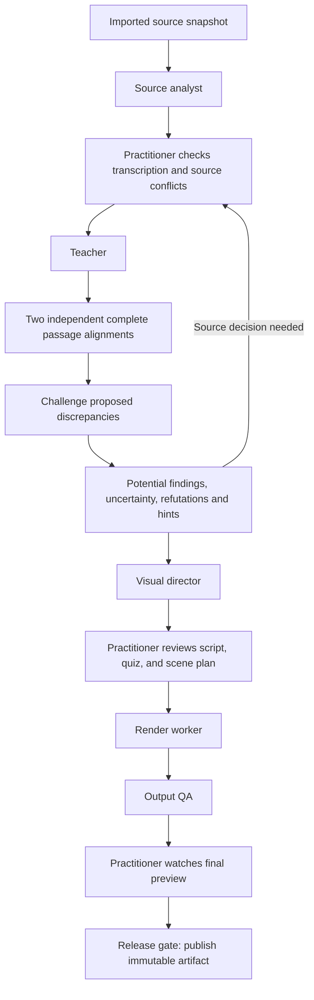

# Offline multi-agent architecture and production gates

## Decision

An end-to-end offline system with several specialized agents is a feasible direction for this project. Agents can run sequentially on one workstation; they do not require simultaneous model instances or cloud services. However, **the current application is a working development release, not a complete multi-agent system or an industry-validated medical product**. “Google level” is an ambition, not a measurable certification. Release claims should refer to demonstrated reliability, source fidelity, usability, privacy, and deployment evidence.

The editor runs a checkpointed source analyst → teacher → evidence review workflow. Evidence review uses two complete alignment passes that receive no output from each other, then challenges proposed discrepancies. Models select stored passage IDs; application code retrieves the exact quotations. Findings cannot trigger a medical rewrite. Separate prompts and seeds using the same weights provide independent inputs, not independent clinical validation.

The first editorial milestone below is implemented. Later production gates remain a target architecture. Current behavior is described in [PIPELINE.md](PIPELINE.md); test evidence is recorded in [VALIDATION.md](VALIDATION.md), and broader work remains in [ROADMAP.md](ROADMAP.md).

## Implemented editorial milestone

| Component | Implemented contract |
|---|---|
| Evidence packet | Stable IDs for native text, notes, image transcription and table cells. Content/provenance hash includes original deck and rendered image hashes. Editorial revision is tracked separately. |
| Teacher | Source-bound draft plus editorial pass; short spoken thought groups and preserved conditions, numbers, units and qualifiers. |
| Evidence review | Two independent complete source/draft alignments, followed by a challenge to proposed discrepancies. Coverage, unique IDs, source-conflict sides and verifier anchors are validated. Quotations come from immutable stored passages, not model-written text. |
| Review outcomes | Potential findings, unresolved comparisons, refuted proposals and lexical/readability hints remain distinct. Even model agreement is a review suggestion. Every evaluator report forbids automatic revision and clinical approval. |
| Bounded repair | At most one schema/reference repair per review stage. Invalid output still fails after that attempt. This repairs the review response, never the medical script. |
| Context budget | A conservative UTF-8 byte bound plus reserved overhead caps response tokens within the configured context. Insufficient room fails before model access; source is never silently shortened. Exact-text omission guards normalize whitespace only, preserving case-sensitive units. |
| Durable stages | Atomic JSON checkpoints under a private project run directory. Model digest, source, revision, prompts, code, options and style determine reuse. Corrupt/mismatched artifacts are recomputed. Completed stage output is not committed to the slide until the workflow completes. |
| Authoring contract | Build teaching draft or evaluate an existing script. Evaluation stores the assessed revision, findings, source/script excerpts and remediation. Text/source changes invalidate it; a failed attempt retains the prior report with a visible error. |
| Voice boundary | Optional Qwen3-TTS 1.7B CustomVoice in an isolated CUDA process, with fixed narrator/delivery presets and verified local model assets. Ollama generation requests release model residency after a call. A single app worker serializes expensive work. |
| Visual director | Author-defined regions feed Whiteboard, Studio, or Guided focus. Native PowerPoint mode flattens supported existing effects into a complete fitted video timeline; it does not invent missing effects. |
| Output QA | FFprobe checks format/timing; PCM checks flag silence and near-clipping. Naturalness, terminology pronunciation, meaning and comprehension remain explicit listening/reviewer assessments. |

The durable editorial checkpoints do **not** implement database-backed worker leases, normalized migrations, resumable media generation, signed reviewer identity or a packaged offline installer. Synchronous Ollama requests currently acknowledge cancellation after response or timeout; voice/native-render subprocesses can be terminated. These limits are tracked below rather than hidden behind agent labels.

## Current evidence and the proposed change

| Concern | Current implementation | Proposed change |
|---|---|---|
| Job orchestration | One app worker plus a local model lock; project job status, cancellation tokens, startup recovery and atomic editorial stage checkpoints. | Persist normalized run/stage records, leases and restart-resumable media jobs. |
| Persistence | `backend/store.py`: SQLite WAL transactions; each project is one JSON document. | Keep project APIs while adding normalized run, stage, artifact, review, and publication records through migrations. |
| Source evidence | Safe rendering copy, source text/notes/tables, local OCR and author review. Editorial packets have hashes and stable evidence IDs. | Add verified claim-to-image-region links, robust reading order and source conflict resolution tools. |
| Writing | Source-bound teacher/editor; two independent passage alignments and proposal challenge; stored exact evidence; visible uncertainty, refutations and hints. Critic-triggered revisions are disabled. | Calibrate against educator labels and establish acceptable false-positive/false-negative rates before relying on reviewer suggestions. |
| Review | Revision checks and named approval; source/script/quiz/region changes reset approval. Reviewer names are not authenticated signatures. | Signed review records bound to exact source, script, assessment, visual plan, and final-preview revisions. Authentication for organizational deployments. |
| Visual output | `backend/compositor.py`, `backend/visual_cues.py`, `backend/whiteboard.py`: reviewed source-region animation, captions, full-source overview. | Visual director proposes an evidence-linked scene plan. Practitioner accepts regions and sequence; a deterministic renderer executes the accepted plan. |
| Audio and reading | Local voice synthesis; caption estimates are separate from complete reading passages. | Versioned pronunciation decisions, tested alignment when needed, explicit timing confidence, and audio/video review tied to final artifacts. |
| Output checks | `backend/media.py`: ffprobe validation and export metadata; portable HTML/ZIP packaging. | Separate output-QA worker with structural, visual, audio, accessibility, package, and release-manifest checks. |
| Offline enforcement | Loopback inference, proxy inheritance disabled, local OCR assets checked, runtime OCR downloads disabled. | Network-denied worker processes and tested offline installation. Independently installed converters/model runtimes currently remain outside an application-managed network sandbox. |

### What the model trials established

The supplied slides 4, 6, and 13 exposed source omissions and meaning changes. Observed 4B rewrites strengthened qualifiers: “usually” disappeared, “many” became “most,” and conditional language became a stronger assertion. The 9B model retained more equipment values in some comparisons but still had omissions and qualifier/source-scope problems. Neither model passed a general medical narration assessment.

Reasoning-enabled trials consumed their output allowance without producing usable final narration. Thinking is therefore disabled in the current narration calls. Empty, malformed, and truncated responses fail rather than falling back to the unreviewed first draft. Hand-edited Codex corrections are separately identified; they are not evidence that a local model passed.

These failures motivate explicit evidence contracts and practitioner gates. A second model, another prompt, or agreement among critics does not establish clinical accuracy. Source material itself can be wrong or internally inconsistent.

## Proposed local workflow

Unresolved source conflicts may be excluded from a draft only with an explicit omission record. An agent cannot settle them by selecting whichever wording reads better. Practitioner resolution creates a new accepted-source revision; the original evidence remains unchanged and visible.

### Role contracts and permissions

Each role receives a validated JSON input and an allowlisted tool surface. The scheduler, not the language model, assigns paths, resources, retry policy, and publication permissions. Source text and other agents' outputs are untrusted data.

| Role | Exact input | Required output | Permitted tools and limits |
|---|---|---|---|
| Source analyst | Source packet ID; original/sanitized deck hashes; slide PNGs; extracted text spans, notes, tables; local reference documents explicitly supplied by the author. | `EvidencePacket`: per-slide evidence IDs, source type, original wording, bounding box or note/table coordinates, OCR confidence, unresolved transcription issues, candidate conflict pairs, reference provenance. Never a clinical verdict. | Read-only OOXML parser, isolated renderer, local OCR, deterministic comparisons. Optional local visual model may propose regions/transcriptions with uncertainty. No web retrieval, file edits outside its output directory, or acceptance of source changes. |
| Teacher | Accepted evidence packet; audience and style; explicit included/excluded claim scope; reviewer-resolved conflicts; pronunciation decisions. | `TeachingDraft`: ordered claim IDs with evidence links; spoken paragraphs; optional question/options/answer/explanation with evidence links; omitted/uncertain material. Preserve values, units, negation, conditions, and sequence. | Local text inference and deterministic readability/unit diagnostics. No converter, arbitrary shell, networking, project approval, or generated clinical facts. Unsupported definitions/examples remain author requests. |
| Independent fidelity critic | Original accepted evidence packet, teacher draft, included/excluded scope, deterministic diagnostics. No teacher reasoning or self-assessment. | `CriticReport`: claim-level supported/contradicted/unclear status; exact supporting or conflicting spans; added/omitted claims; altered qualifiers/units/sequence; source conflicts; actionable edits. `ready_for_human_review` is a workflow suggestion, never approval. | Read-only evidence lookup, local inference, deterministic quantity/negation checks. Cannot modify accepted source or mark findings resolved. Same-model critics have correlated failure risk; record model/prompt identity and measure that risk. |
| Visual director | Practitioner-reviewed teaching draft; original slide images; evidence regions; requested style; accepted reveal order and accessibility constraints. | `ScenePlan`: each scene's source image/hash, complete source transform, authored region coordinates, exact label, linked claim IDs, order, timing anchor, caption-safe bounds, final overview, proposed alt text. | Local scene planning plus deterministic geometry/preview tools. Only source-backed visual assets. No invented anatomy, procedural movement, hidden cropping, diagnosis, or unilateral reordering of clinical steps. Suggestions require practitioner acceptance. |
| Render worker | Approved immutable script/scene snapshot; checked pronunciation map; model/voice hashes; versioned renderer recipe and export settings. | Audio blocks, captions with timing provenance, complete reading passages, scene frames, MP4, HTML package, manifest, artifact hashes, processing measurements. | Owned subprocesses for PowerPoint/LibreOffice conversion, local TTS, compositing, FFmpeg. No writing model and no alteration of approved wording or claims. Refuse mismatched hashes/revisions. |
| Output QA | Completed candidate artifacts; expected approved snapshot; render manifest and source-region geometry. | `QAReport`: required-check results, artifact hashes, measured AV timing, missing/clipped assets or labels, package/link integrity, caption duplication/overflow, reading-transcript agreement, accessibility checks, unresolved playback/pronunciation tasks. | ffprobe, bounded media decode, image/layout checks, local browser harness, package validator. Speech recognition may propose mismatches but cannot certify medical pronunciation or speech correctness. No publish permission. |

The release service is deterministic software, not an agent. It checks signatures/revisions, mandatory QA results, unresolved findings, and final-preview approval. Only then does it expose the completed immutable artifact for distribution. Ordinary drafting and previews remain available without granting release approval.

### Private draft previews are a separate path

The current CLI `scripts/render_draft_preview.py` supports explicitly requested private, unapproved previews. This path may synthesize draft narration before clinical review so the author can evaluate writing, voice, source visibility, and timing together. It carries a permanent **UNAPPROVED / FOR REVIEW ONLY** banner, writes to ignored private validation storage, and does not change project approvals or produce a released learner package. The actual supplied-slide preview is recorded in [VALIDATION.md](VALIDATION.md); its 72.5-second media result demonstrates preview execution, not clinical or pronunciation validation.

The proposed scheduler should represent this as a distinct `draft_preview` artifact class with explicit request scope and no route to publication. A preview cannot satisfy the reviewed export gate by being relabeled, copied into a publication record, or merely watched. Approved release still requires the evidence/script/scene/final-artifact decisions below. The private preview path is useful for iteration precisely because its provenance and unapproved status remain clear.

## Durable execution and recovery

### Minimal records

- `runs`: run ID, project ID, selected slides, requested recipe, immutable source revision, expected publication revision, cancellation timestamp, overall state.
- `stages`: role, dependencies, input fingerprint, status, checkpoint artifact IDs, resource class, lease owner/expiry, fencing generation, retry budget.
- `attempts`: stage ID, attempt number, executable/model/prompt versions, start/end time, exit cause, resource measurements, bounded local logs, output validation result.
- `artifacts`: immutable hash, size, media type, relative storage key, producer attempt, input fingerprint, completeness and validation state.
- `reviews`: authenticated reviewer where required, reviewed artifact hashes/revisions, accepted conflict decisions, explicit omissions, approval scope/time, invalidation links.
- `publications`: final manifest hash, exact reviewed snapshot, QA report hash, final-preview review, committed artifact locations.

Project JSON may remain a UI projection. It must not be the only record of multi-stage execution.

### Fingerprints and invalidation

Compute a canonical input fingerprint from original file hash, sanitized file hash, rendered source-image hash, accepted transcription/evidence revision, ordered claim/scene scope, model and voice asset hashes, prompt version, decoding configuration, renderer/dependency versions, and export settings. Preserve ordering and numeric spelling in source evidence; hash canonical serialization, not a paraphrase. Filesystem paths are storage references, not source identity.

Changing an upstream artifact invalidates dependent checkpoints and their review. Changing only caption appearance can reuse approved source/script/audio, but it requires a new render/QA/final-preview approval. Editing a source qualifier invalidates downstream writing, visual claim mapping, and release approval. Never attach a prior approval to a new fingerprint.

### Idempotency and publication

Use `(run, stage, input fingerprint)` as the stage's idempotency key. One lease owner may produce a result; a fencing generation prevents a late worker from committing after its lease has been replaced. Artifacts are written into attempt-specific temporary directories, closed, hashed, and validated before they become checkpoints.

Publish by an atomic manifest-pointer transaction after files are complete. A database transaction cannot atomically rename files across an arbitrary filesystem: recovery must reconcile unreferenced complete files and incomplete attempts. Do not claim exactly-once execution. Require effectively-once publication and prove that retries cannot expose duplicate, partial, stale, or unapproved exports. Retain immutable prior publications; a new edit creates a new artifact.

### Failure and retry policy

- Retry transient process/startup or storage-lock errors at most twice with bounded backoff, while preserving the input fingerprint. Record each attempt.
- Do not automatically retry unsupported input, missing runtime/assets, source contradictions, disk exhaustion, exhausted model context, or reviewer rejection. Surface a specific corrective action.
- Never let a critic report trigger a medical rewrite. Route potential findings and unresolved comparisons to the practitioner. Permit at most one schema/reference repair per review stage; this does not authorize changing source or narration. Do not run an unbounded agent debate.
- Reject malformed, empty, or truncated model output. No silent first-pass fallback, source truncation, remote-provider fallback, or model substitution.
- On restart, recover leases and validate artifact hashes. Reuse only completed, matching checkpoints; rerun interrupted native stages in a fresh temporary directory. A failed final encode must not require repeating already verified transcription or approved speech.
- Apply disk quotas, check available space before expensive stages, and offer explicit retention/cleanup controls. Never remove original imports, review evidence, or published artifacts merely to complete a new job.

### Cancellation

Persist cancellation before acknowledging it. Prevent dependency scheduling and publication immediately. Check the token before/after every model/native call and at safe boundaries inside CPU loops. Current code checks between writing passes but cannot interrupt an already-blocking Ollama request until it returns or times out.

For tighter cancellation, run inference/conversion under owned worker processes and cancellable transports. Allow a short graceful stop, then terminate only the owned job/process tree, using operating-system containment where supported. Do not terminate a user's unrelated PowerPoint or shared Ollama session. Stop leases, keep completed checkpoints, quarantine partial files, and verify no late worker can publish after cancellation.

## Workstation resource plan: an 8 GB GPU

This is a resource-constrained local scheduler, not a cluster of simultaneously resident models.

- Allocate one inference lease at a time across source-analysis visual models, teacher, critic, and any GPU voice engine. The role graph may be concurrent while its GPU stages run sequentially.
- Start with a measured GPU allocation ceiling around 6 GB, reserving the remainder for the display/runtime and transient buffers. This is a proposed budget, not proof that a particular 9B model/context fits. Benchmark actual quantization, context length, CPU offload, and peak memory on the target machine.
- Use OCR and deterministic parsing on bounded CPU workers; the current OCR path already targets CPU. Start with one render/export worker and limit CPU thread counts to keep authoring responsive.
- Do not assume 4B is safe because it is smaller, or 9B is safe because it retains more numbers. Select a locally installed model through a tested runtime profile and expose its measured limitations. An out-of-memory event should stop/requeue with guidance, never silently change the model.
- Reuse one model instance across sequential text roles when necessary; separate their prompts, inputs, output schemas, and state. Role separation does not create statistical independence. Evaluate a different critic model only when it fits and materially improves held-out results.
- Bound source and editor input before dispatch. Prefer token-aware checks for the selected tokenizer; current character caps are approximations. Never silently drop context to meet a budget.
- Record wall time, CPU/RAM/GPU peaks, generated tokens, output size, and cancellation latency. Use these measurements for profile selection and progress estimates. Do not promise real-time rendering or fixed quality solely from a parameter count.

## Practitioner release gate

The existing source checkbox and named revision approval are useful foundations. A production gate needs separate, traceable decisions:

1. Confirm the source transcription, especially reading order, quantities, units, and image labels. Resolve contradictions or explicitly exclude disputed content from this lesson's scope.
2. Review claim-to-source links, spoken explanation, terminology, conditions, procedural order, assessment answer/feedback, region placement, and reveal sequence. Automated critic findings remain visible until a reviewer records a decision.
3. Inspect the actual rendered preview and listen to the entire selected narration. Check medical pronunciation, captions, label visibility, source completeness, reveal timing, and learner interactions.
4. Bind approval to the exact final manifest and QA report. Any material change revokes the dependent release approval. Authenticated signatures and organizational policy controls are needed before claiming institutional review provenance.

Source fidelity and clinical validity are different checks. An accurately reproduced slide may still contain an outdated or incorrect claim. The system cannot use agent agreement, OCR confidence, readability scores, or citation presence as a substitute for clinical review. Offline reference material must be supplied, dated, and governed explicitly; this design does not imply automatic verification against current guidelines.

## Rollout and measurable acceptance

The following are **proposed acceptance targets**, not achieved benchmarks. Fix the hardware profile, supported file types, corpus, and measurement method before a release comparison.

| Milestone | Deliverable | Acceptance evidence |
|---|---|---|
| 1. Evidence contracts | Source packets, immutable revisions, claim links, source-conflict decisions. | Every accepted claim points to an existing source span/region. Every tested source edit invalidates affected downstream reviews. Fixtures cover notes/image disagreement, repeated numbers, units, negation, tables, OCR errors, and reading order. No source is silently truncated. |
| 2. Durable local orchestration | Stage database, leases, checkpoints, idempotent publication, cancellation. | Fault injection at every stage and commit boundary: zero partial/unapproved publications and zero cross-project writes. Restart resumes verified checkpoints. Repeated requests publish one artifact per idempotency key. At least 100 injected interruption/retry runs pass before claiming recovery support. |
| 3. Teacher and critic evaluation | Versioned local corpus and blind practitioner scoring, including existing 4B/9B failures. | Initial held-out set of at least 300 permission-cleared slides spanning at least six specialties and text/image/table layouts. Report added/omitted claims, qualifier/unit changes, unresolved conflicts, reviewer correction time, and critic false negatives/positives separately. Include at least 100 seeded high-risk wording/value changes. Do not turn a mean score or seed-test success into automatic clinical approval. |
| 4. Reviewed visual direction | Scene contracts, previews, source geometry, reading/caption separation. | All accepted source regions remain inside their images; all labels/captions fit tested layouts; complete-source overview remains available. Zero silent label/quantity truncations in the supported fixture set. Practitioner inspection confirms each final scene's intended meaning and order. |
| 5. Render and output QA | Verified media/package artifacts and repeatable playback tests. | Required video/audio/subtitle streams; no decoder errors; AV duration discrepancy at most 150 ms; transcript preserves reviewed wording except documented whitespace normalization. Test both burned/native captions and prevent duplicate tracks. Validate seeking, quizzes, text search, full ZIP extraction, and local-file launch in each supported browser. Word-aligned caption claims require separate alignment measurement. |
| 6. Offline packaging and operations | Signed Windows installer, asset/license inventory, updates/rollback, process containment. | Fresh-machine install from an offline distribution bundle; all shipped asset hashes verified. Entire import-to-export workflow completes with egress denied. Network monitoring reports zero successful external connections from application-owned processes. Exercise missing assets, malformed input, disk-full conditions, rollback, and uninstall without deleting user projects. |
| 7. Practitioner usability and controlled release | Accessibility evidence and observed end-to-end practitioner tasks. | At least 12 representative practitioners complete import, source correction, narration review, region authoring, final review, and export. Target at least 90% unassisted completion of each critical task; record correction time and review errors. No unresolved critical keyboard/screen-reader blockers in the supported workflow. Publish findings and remaining limits rather than a blanket quality label. |

Operational targets should include a responsive UI while work runs, cancellation acknowledgement within one second, and no publication after cancellation. A stronger native-worker stop target of five seconds requires the proposed process-isolation work and hardware testing; it is not a promise of the current blocking inference implementation.

For release, zero known critical defects may remain in the declared supported workflow. Every released lesson still requires the practitioner gate, regardless of model benchmark results. Expand platforms, languages, specialties, animation types, and organizational deployment claims only as their own acceptance evidence becomes available.

### Calibrate the critic before using its recommendations

Build educator-labeled examples with claim-level source links, error type, severity, and an adjudicated disposition. Split by presentation/topic rather than random sentences so near-duplicate material cannot leak into the held-out set. Keep prompt-tuning cases separate from the final evaluation; report results by model, prompt, source modality, and error class.

Measure false accepts explicitly: drafts the critic marks ready despite an educator-confirmed unsupported or meaning-changing claim. Also measure missed omissions, false alarms, parse failures, empty/truncated output, unresolved cases, and reviewer time. Parse failures and abstentions remain in the denominator and must not be counted as clean answers. Report sample sizes and uncertainty, not only a single average score. Recalibrate after changing prompts, model weights, OCR, decoding, or source packaging.

Several prompts using the same weights do not provide independent clinical validation. Even different models may share correlated errors. Calibrated critic performance can help prioritize a practitioner's attention; it cannot authorize clinical release. Store evaluation traces and rubric results locally. This design requires no Langfuse cloud account, cloud telemetry, or submission of presentation content to any external evaluation service.

## Immediate implementation order

1. Stabilize the current source/OCR/review experience and retain honest model-evaluation results.
2. Introduce durable stage and artifact records behind current APIs, with migrations and failure-injection tests.
3. Add evidence IDs and structured claim mapping before adding more inference calls.
4. Calibrate the implemented independent alignment/challenge review against the earlier single-critic baseline. Keep automated medical rewriting disabled.
5. Add proposed visual plans and independent output QA, then final-artifact review.
6. Package and validate the fully disconnected workstation workflow before organizational rollout.

The important architectural change is accountable, recoverable work with explicit evidence and release authority. Agent names and additional prompts are implementation details; they are not evidence of medical correctness or production readiness.
