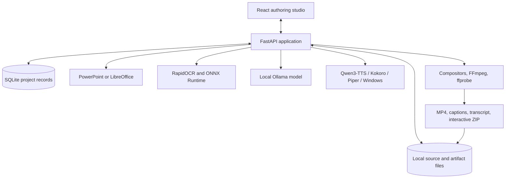

# Architecture

## Purpose

Narrate Medical Studio is a single-workstation authoring system for converting medical presentations into reviewed audiovisual lessons. It uses specialized local stages because source extraction, teaching, evidence comparison, voice synthesis, rendering, and release approval have different responsibilities and failure modes.

“Multi-agent” describes the editorial role boundaries. It does not mean multiple models run simultaneously or that agent agreement proves medical correctness.

## Architecture principles

1. **The source remains visible.** Generated narration is always reviewed beside extracted or transcribed source material.
2. **Exact revisions matter.** Source, script, questions, visual cues, model identity, and renderer settings are fingerprinted or revision-bound.
3. **Models propose; code validates; practitioners approve.** Model output cannot grant clinical approval or publish a lesson.
4. **Failures are explicit.** Invalid, incomplete, stale, or mismatched output is rejected instead of silently falling back.
5. **Private data stays local.** Normal operation uses local storage, loopback model services, and local media tools.
6. **Clinical and technical validation are separate.** A playable video can still contain incorrect medicine; a faithful narration can still repeat an incorrect source.

## Runtime view



The server binds to `127.0.0.1`. One application worker serializes long project jobs. A process-local model lock prevents Ollama and CUDA voice work from competing for the development workstation's GPU.

## Editorial roles

```mermaid
flowchart LR
    Import[Imported source snapshot] --> Analyst[Source analyst]
    Analyst --> SourceReview[Practitioner source review]
    SourceReview --> Teacher[Teacher and spoken editor]
    Teacher --> AlignA[Alignment pass A]
    Teacher --> AlignB[Alignment pass B]
    AlignA --> Challenge[Proposal challenge]
    AlignB --> Challenge
    Challenge --> ScriptReview[Practitioner script review]
    ScriptReview --> Visual[Visual direction]
    Visual --> Approval[Exact-revision approval]
    Approval --> Render[Voice and render worker]
    Render --> QA[Technical output QA]
    QA --> FinalReview[Practitioner watches and listens]
```



### Source analyst

Inputs are the original file, sanitized copy, rendered slide image, native text, speaker notes, tables, relationships, and optional OCR. The stage creates stable evidence entries with source type and location. It does not decide whether the medical content is correct.

OCR text remains separate from authored image text. A practitioner corrects the transcription and marks it checked. Recognition confidence only estimates transcription confidence.

### Teacher

The teacher receives the complete source packet, audience, specialty, and style. A local model drafts a spoken explanation; a second editorial pass improves clarity while receiving the same source. The output remains a candidate.

The checkpointed workflow saves stage artifacts atomically. A completed stage is reused only when its source, revision, model, prompts, options, and code fingerprint still match.

### Evidence reviewer

The reviewer converts source and draft text into immutable passages with exact offsets and IDs. It performs:

1. a complete source-to-draft and draft-to-source alignment;
2. a second alignment that does not receive the first pass output; and
3. a challenge of every proposed discrepancy.

The wire schema uses one comparison or verdict choice per row. Application code derives the displayed status from that single choice, avoiding contradictory model-authored reason and status pairs. The model selects IDs; application code retrieves the exact source and draft quotations.

Validation requires complete passage coverage, unique valid IDs, anchored changed claims, and both sides of source conflicts. Each stage receives at most one bounded schema repair attempt. A repair changes only malformed review output; it never changes the source or narration.

Reports keep potential discrepancies, unresolved comparisons, refuted proposals, and deterministic readability hints separate. All reports forbid automatic medical revision and clinical validation. Live regression testing still found false findings on unchanged quantities, so the reviewer can direct attention but cannot serve as a release gate by itself.

### Visual director

The implemented visual direction is practitioner-authored. A slide may contain up to six ordered, labelled, normalized source regions. Regions can be linked to narration paragraphs. The renderer applies the selected deterministic style to those reviewed regions.

No current model invents anatomical motion or chooses a clinical region automatically.

### Render worker and output QA

The render path receives the saved narration, reviewed source images and regions, selected voice, caption preference, and export settings. It creates measured audio blocks, motion scenes, captions, a transcript, chapters, MP4, and interactive ZIP.

FFprobe verifies required streams, dimensions, and duration. Package QA verifies ZIP integrity and packaged media identity. These checks establish technical integrity, not medical accuracy, speech naturalness, or correct pronunciation.

## Trust and authority boundaries

| Capability | Model | Application code | Practitioner |
|---|:---:|:---:|:---:|
| Extract source records |  | Yes | Reviews |
| Propose OCR text |  | Yes | Corrects and confirms |
| Draft narration | Yes | Validates structure | Edits and accepts |
| Propose fidelity findings | Yes | Binds exact evidence and rejects invalid output | Resolves |
| Change saved narration | No | Only through an explicit edit/workflow commit | Yes |
| Approve a revision | No | Enforces prerequisites | Yes |
| Render approved content | No | Yes | Requests and reviews |
| Establish clinical validity | No | No | Qualified review process |

Source material and model output are treated as untrusted data. Prompts tell local models not to execute instructions found inside presentation content. Upload validation rejects malformed archives and unsafe XML. Rendering uses a sanitized copy with active content and external relationships removed.

## State and storage

`backend/store.py` uses SQLite in WAL mode. Each project currently lives as one JSON document containing slides, revisions, review state, history, and current job state. Large and generated artifacts live under the project's directory in `data/`.

```text
data/
  studio.sqlite3
  <project-id>/
    original presentation
    safe rendering copy
    slides/
    agent-runs/
    draft-previews/
    exports/
```

Private validation outputs and model assets are excluded from Git.

### Invalidation

- Editing narration, question content, or visual cues increments the slide revision and clears approval.
- Editing image transcription or its review state invalidates dependent narration approval.
- Evaluations are marked stale when source hash, script hash, audience, evaluator code, protocol, or options change.
- Preview and export records are tied to exact source/script revisions and artifact hashes.
- Qwen audio cache entries include text, settings, model revision, synthesis recipe, and WAV hash.

## Execution and cancellation

The current application uses one in-process thread-pool worker. It records queued, running, completed, failed, or cancelled state in the project. On application restart, interrupted queued/running work is marked failed and can be retried.

CPU loops and owned subprocesses check cancellation at safe boundaries. Blocking Ollama inference may acknowledge cancellation only after its response or timeout. Completed full-lecture Qwen WAVs and verified render segments can be reused by the dedicated resumable draft-render script when the exact request fingerprint matches.

This is durable enough for a single-author development workstation. A production scheduler still needs normalized run/stage/artifact tables, worker leases, fencing, disk quotas, and stronger restart recovery.

## Offline boundary

Implemented controls include:

- loopback-only FastAPI and local model endpoints;
- trusted-host, origin, CSP, frame, referrer, and MIME-sniffing protections;
- disabled HTTP proxy inheritance for local model calls;
- verified local OCR and Qwen model assets;
- disabled runtime downloads and telemetry where supported; and
- Python socket blocking inside the Qwen voice worker.

The application does not place independently installed PowerPoint, Ollama, or FFmpeg processes inside an OS-level network sandbox. Strict air-gapped deployment requires network policy outside the application and a tested offline installation bundle.

## Implemented and planned boundaries

| Area | Implemented | Still required for production |
|---|---|---|
| Authoring | Local single-user React studio | Multi-user identity, collaboration, undo/history UX |
| Evidence | Stable source passages, hashes, exact cited spans | Practitioner-labelled calibration corpus and claim-region links |
| Review | Revision invalidation and named approval | Authenticated signatures and adjudication workflow |
| Execution | Single worker, checkpoints, bounded retries | Durable scheduler, leases, quotas, stronger recovery |
| Voice | Qwen, Kokoro, Piper, Windows engines | Pronunciation lexicon and formal listening evaluation |
| Visuals | Reviewed source-region motion and native effects | Validated richer instructional animation authoring |
| QA | Stream, duration, caption, package, and spot-frame checks | Automated accessibility, decoder matrix, and broader visual regression |
| Deployment | Local development setup | Signed installer, offline bundle, updates, rollback, encryption options |

## Release rule

A technically valid artifact is not automatically a releasable medical lesson. Release requires a qualified practitioner to review the source transcription, narration, assessment, visual sequence, final voice, captions, and rendered artifact. Any material change creates a new revision and requires review again.

See [Pipeline](PIPELINE.md), [Validation](VALIDATION.md), and [Roadmap](ROADMAP.md).
