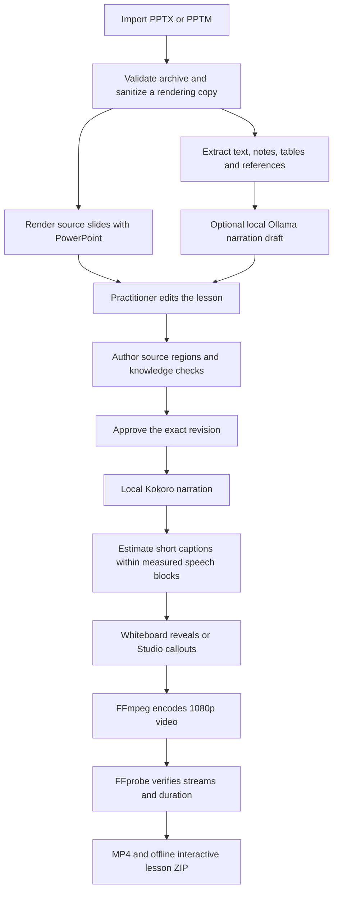

# Application pipeline

All processing below runs on the workstation after dependency and model setup.

## Source and review

The uploaded original is retained locally. Conversion operates on a copy with macros, active embedded content, and external relationships removed. Text extraction does not perform OCR or interpret anatomical images. Ollama receives source text as untrusted content and returns a structured draft with review flags.

The author supplies diagram regions, labels, narration, and any assessment. An edit to narration, a question, or a visual region invalidates its approval. The API checks slide revisions to prevent stale browser windows overwriting newer reviews. Export snapshots the reviewed lesson and writes its source hash, settings, review metadata, and quality results into a manifest.

## Voice and timing

Kokoro runs from pinned local ONNX and voice-bank files. Complete thoughts are synthesized together so subtitle lengths do not cause clipped, repetitive speech. Four narrator presets and a pace control are available. The voice audition uses a fixed nonmedical script.

Audio duration is measured from generated PCM. Short caption boundaries are estimated proportionally within the measured speech passages; they are not forced-aligned word timestamps. Per-slide PCM is padded to video frame boundaries and joined before one AAC encode, preventing cumulative padding drift.

Voicebox and Qwen TTS are not integrated. Piper and Windows speech are alternative installed engines.

## Visuals and interaction

Whiteboard reveals the author's selected source regions in order, retaining completed regions and showing the full source at the end. Studio preserves the complete slide and adds animated callouts and chapter cards. Cue progression is evenly paced, not anchored to individual spoken phrases. Neither mode generates new medical anatomy or recreates original PowerPoint animations.

The exported learner page contains chapter navigation, searchable and seekable transcript, caption controls, playback speed, questions with explanations, and session-only reflection notes/progress. Its HTML, media, caption data, and code are packaged together without remote libraries.

## Verification used during development

1. Automated source-validation, revision, approval, concurrency, caption, region, and packaging tests.
2. TypeScript checking, production build, and formatting checks.
3. Synthetic PowerPoint → real renderer → real neural speech → both video styles.
4. Live HTTP workflow through import, rendering, approval, export, and validated downloads.
5. Visual frame inspection and browser inspection of authoring controls.

See [VALIDATION.md](VALIDATION.md) for measured results and limitations, including the browser tool's local-file restriction and the embedded-browser playback crash.
