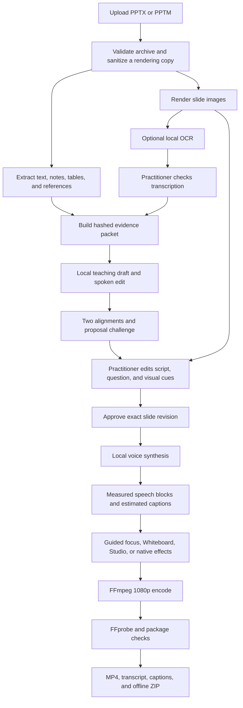

# Application pipeline

This document describes the implemented workstation pipeline. All content processing runs locally after dependencies and models have been installed.

## End-to-end flow



## 1. Import and sanitization

The API accepts `.pptx` and `.pptm` up to 150 MB. It validates the ZIP container and rejects unsafe XML before extraction. The original upload is preserved locally.

Rendering operates on a separate safe copy. The sanitization step removes macros, active embedded objects, and external relationships while keeping the content needed for static rendering. The original presentation is never modified.

`backend/extract.py` reads native slide text, speaker notes, tables, image counts, and reference relationships. Each source retains its type and location.

## 2. Slide rendering and OCR

The tested Windows path uses Microsoft PowerPoint to render high-resolution slide images. LibreOffice can be selected with `NARRATE_SOFFICE`, but cross-platform behavior is not yet validated to the same level.

RapidOCR runs locally through ONNX Runtime for image-heavy slides. `scripts/download_ocr.py` prepares and verifies the assets bundled with the pinned dependency. Runtime downloads are disabled.

OCR produces candidate lines, normalized image boxes, and recognition confidence. It does not update practitioner-authored image text automatically. The author compares the result with the rendered slide, fixes reading order, punctuation, terminology, values, and units, then explicitly marks it checked.

## 3. Evidence packet

The application builds an evidence packet from native text, notes, table cells, and authored image transcription. Entries receive stable IDs and locations. The packet hash includes the source deck and rendered image identity, so stale assessments cannot be reused after source changes.

Image transcription, its review state, and editorial revision remain visible. A source conflict is preserved rather than silently resolved.

## 4. Teaching draft

`Build teaching draft` invokes the checkpointed local workflow. The teacher produces a source-bound spoken explanation for the configured audience and specialty. A second local editorial pass improves spoken structure while receiving the same source.

Stage outputs live under:

```text
data/<project-id>/agent-runs/<run-id>/<fingerprint>/
```

Atomic writes and input fingerprints allow completed stages to be reused only when the source, revision, local model digest, prompts, options, and code still match. Empty, malformed, truncated, or mismatched output fails the stage. There is no cloud or substitute-model fallback.

## 5. Evidence review

`Evaluate saved script` inspects narration without changing it. Source and draft are divided into exact passages with immutable IDs and offsets.

The protocol runs two complete alignments. The second receives the same evidence but does not receive the first result. Proposed discrepancies from either pass then receive a challenge pass. The schema requires one source check for every source passage and one draft check for every draft passage.

The model selects only passage IDs and a single comparison/verdict value. Application code derives status and retrieves exact quotations. This prevents fabricated displayed quotes and contradictory reason/status fields. Integrity checks require valid unique references, complete coverage, relevant changed-claim anchors, and both sides of a source conflict.

At most one bounded schema repair is allowed per stage. It repairs malformed review output only. It does not alter medical content.

The output distinguishes potential findings, uncertainty, refuted proposals, and deterministic editing hints. Findings cannot trigger an automatic medical rewrite, approval, or publication. Live validation still found false findings on unchanged quantities; every result requires human comparison with the source.

## 6. Authoring and approval

The practitioner edits narration, an optional three-choice knowledge check, and up to six labelled visual regions. Regions use normalized center coordinates and dimensions and can be linked to narration paragraphs.

Approval records the reviewer label and exact slide revision. These changes clear approval:

- narration text;
- question, choices, answer, or explanation;
- source transcription or its checked state;
- visual-region label, position, size, paragraph link, or order.

The API checks revisions to prevent a stale browser window from overwriting newer work. Populated image transcription must be checked before approval.

## 7. Preview and voice

Voice audition uses a fixed nonmedical sample. A slide preview uses the current saved script and visual plan and burns `DRAFT / UNAPPROVED / FOR REVIEW ONLY` into every frame. Creating or watching a preview does not approve the slide.

Available engines are:

- Qwen3-TTS 1.7B CustomVoice for expressive CUDA narration;
- Kokoro ONNX for faster local neural speech;
- Piper as a compact local alternative; and
- Windows speech when available.

Qwen receives adjacent natural thought blocks in batches of at most two. It preserves output order and records measured cues for each original block. Verified slide WAVs are cached by text, settings, model revision, synthesis recipe, and file hash.

See [Voice and motion](VOICE_AND_MOTION.md).

## 8. Timing and scene rendering

Each natural speech block has a measured audio duration. A 0.18-second gap separates Qwen blocks. Caption cues are estimated within measured blocks; they are not word-level forced alignment.

The renderer adds a lead-in and tail, aligns scene duration to 24 fps, and uses paragraph-linked starts for authored visual regions. Slide PCM is joined before one AAC encode to avoid accumulating compression padding.

Visual modes:

- **Guided focus:** camera movement into reviewed source regions.
- **Whiteboard:** progressive source-region reveal followed by the full slide.
- **Studio:** full-slide view with timed callouts.
- **PowerPoint effects:** supported animations and transitions already present in the sanitized deck.

Slides without cues retain the full source. No mode invents medical imagery or procedural motion.

## 9. Encode, QA, and packaging

FFmpeg produces 1920×1080 H.264 video, AAC audio, and optional selectable subtitles. Captions can also be burned into the image.

FFprobe verifies required streams, dimensions, codec types, and expected duration. PCM checks measure level, clipping, and long silence. The interactive package contains:

```text
index.html
presentation.mp4
captions.srt
captions.vtt
transcript.txt
README.txt
manifest.json
quality.json
chapters.json
source-flags.json
provenance.json
```

The learner interface works without a server after the ZIP is extracted. It includes chapters, transcript search and seeking, playback speed, caption controls, questions with explanations, and session-local progress.

## Failure and recovery behavior

- Only one long application job runs at a time.
- Cancellation prevents further stages and is checked around model/native calls and inside CPU loops.
- A blocking Ollama request may return only at completion or timeout.
- Application restart marks an interrupted in-process job failed so the user can retry.
- The dedicated full-draft renderer reuses only matching, verified Qwen WAVs and video scenes.
- Partial outputs are not registered as successful previews or exports.
- Export requires approved revisions; private draft scripts produce permanently watermarked artifacts through a separate path.

## What verification means

Technical QA establishes that an artifact is complete and playable. It does not establish:

- clinical correctness;
- source correctness;
- absence of narration omissions;
- natural medical pronunciation;
- learner comprehension; or
- institutional approval.

Those decisions remain part of practitioner review. See [Validation](VALIDATION.md) for current evidence.
