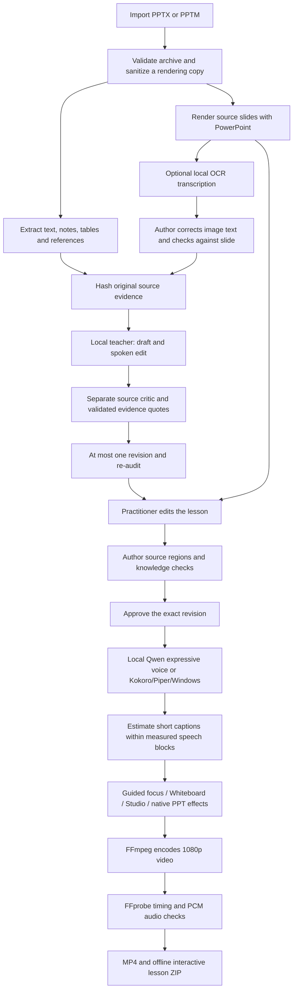

# Application pipeline

All processing below runs on the workstation after dependency and model setup.

## Source and review

**Create slide preview** runs the saved source/script through a private, permanently watermarked video job before clinical approval. It stores only a revision-bound preview record and never changes narration, source review or approval. The API exposes only successfully verified, registered MP4 previews; incomplete jobs and arbitrary project files are not downloadable. This path does not create a released lesson ZIP.

The editor's **Build teaching draft** explicitly selects the multi-role workflow. The API retains its legacy two-pass default for older clients; pass `workflow: "agents"` for the checkpointed workflow. **Evaluate script** assesses the current saved script without rewriting it or changing approval. Evaluation requires visible image text for image-only slides. Exact evidence quotations are checked before findings can be saved. Empty findings mean “needs review,” never “clinically passed.” Source/script edits invalidate assessments.

Role artifacts are local JSON with atomic writes and hashed inputs under `data/<project>/agent-runs/<run>/<fingerprint>/`. Matching completed stages can resume after failure. Source/model/prompt/style changes prevent stale reuse. These are bounded editorial checkpoints, not a distributed production scheduler.

The uploaded original is retained locally. Conversion operates on a copy with macros, active embedded content, and external relationships removed. OOXML extraction reads editable text, notes, and tables. A separate optional OCR step transcribes rendered slide images; neither step interprets anatomy or checks medical validity.

Under **Source > Image text**, run OCR and compare its proposed text with the actual slide. Correct spelling, reading order, numbers, units, and labels, then explicitly mark the transcription checked. OCR returns line confidence and normalized image boxes; its confidence is a recognition score, not confidence in a medical claim. Its result and the author's editable image text are stored separately. A later OCR run does not overwrite existing authored image text.

Drafting also runs OCR automatically when a rendered image-only slide has neither native text nor a saved transcription. It commits the detected source and narration together only after both writing passes succeed. Cancellation or a model failure preserves the previous script and source. The new transcription remains unchecked.

RapidOCR 3.9.2 runs its small PP-OCRv6 detector/recognizer and orientation classifier locally through ONNX Runtime. `scripts/download_ocr.py` prepares the assets already bundled in the installed, pinned RapidAI wheel and extracts the embedded character dictionary. Model and dictionary hashes are checked before use. Runtime model/dictionary/font downloads are disabled; only known project slide PNGs are accepted, and decoded pixels are passed into the dependency. OCR readiness is reported in Setup. A current native inference call must finish before cancellation is acknowledged.

The author supplies diagram regions, labels, narration, and any assessment. An edit to narration, a question, a visual region, or the source transcription/check state invalidates narration approval. Populated image text must be checked before a slide can be approved. The API checks slide revisions to prevent stale browser windows overwriting newer reviews. Export snapshots the reviewed lesson and writes its source hash, image transcription/check state, settings, review metadata, and quality results into a manifest.

## Spoken narration editing

The teacher stage makes two Ollama generation calls. The first produces a spoken draft from extracted text, speaker notes, tables, and available image transcription. The second performs an editorial pass against those same sources, checking the draft's wording, qualifiers, quantities, omissions, and source disagreements while improving sentence structure. Sources and the initial draft are treated as untrusted data, not instructions. The checkpointed workflow then runs a separate source critic, with bounded revision/re-audit where appropriate. The result is a structured, unapproved narration with review flags and diagnostic information.

The current prompt version is `medical-source-v5-editor`; it is still being evaluated. An editorial pass or favorable readability score does not establish that the output preserves every fact. Authors must compare the final script with all accepted source material, especially where notes qualify or contradict visible slide text. An unresolved disagreement needs an explicit author decision, not an automatic choice of whichever wording sounds clearer.

`qwen3.5:9b` is installed and tuned on the development workstation as a higher-capacity local writing option. The lighter `qwen3:4b` has shown qualifier-preservation errors in evaluation. No general narration-quality pass is claimed for either model. Model speed and suitability depend on the workstation; source fidelity and spoken clarity require separate review.

## Voice and timing

Kokoro runs from pinned local ONNX and voice-bank files. Complete thoughts are synthesized together so subtitle lengths do not cause clipped, repetitive speech. Four narrator presets and a pace control are available. The voice audition uses a fixed nonmedical script.

Audio duration is measured from generated PCM. Short caption boundaries are estimated proportionally within the measured speech passages; they are not forced-aligned word timestamps. Per-slide PCM is padded to video frame boundaries and joined before one AAC encode, preventing cumulative padding drift.

Voicebox and Qwen TTS are not integrated. Piper and Windows speech are alternative installed engines.

## Visuals and interaction

Whiteboard reveals the author's selected source regions in order, retaining completed regions and showing the full source at the end. Studio preserves the complete slide and adds animated callouts and chapter cards. Cue progression is evenly paced, not anchored to individual spoken phrases. Neither mode generates new medical anatomy or recreates original PowerPoint animations.

The exported learner page contains chapter navigation, searchable and seekable transcript, caption controls, playback speed, questions with explanations, and session-only reflection notes/progress. Its HTML, media, caption data, and code are packaged together without remote libraries.

## Verification used during development

1. Automated source-validation, revision, approval, concurrency, caption, region, packaging, and OCR tests, including actual OCR inference with Python networking and dependency downloads blocked.
2. TypeScript checking, production build, and formatting checks.
3. Synthetic PowerPoint → real renderer → real neural speech → both video styles.
4. Live HTTP workflow through import, rendering, approval, export, and validated downloads.
5. Visual frame inspection and browser inspection of authoring controls.
6. Comparison of OCR and draft narration with supplied medical slide images and notes. This identifies transcription and source-fidelity problems; it is not clinical guideline validation or a quality pass for the current editorial prompt.

See [VALIDATION.md](VALIDATION.md) for measured results and limitations, including the browser tool's local-file restriction and the embedded-browser playback crash.
